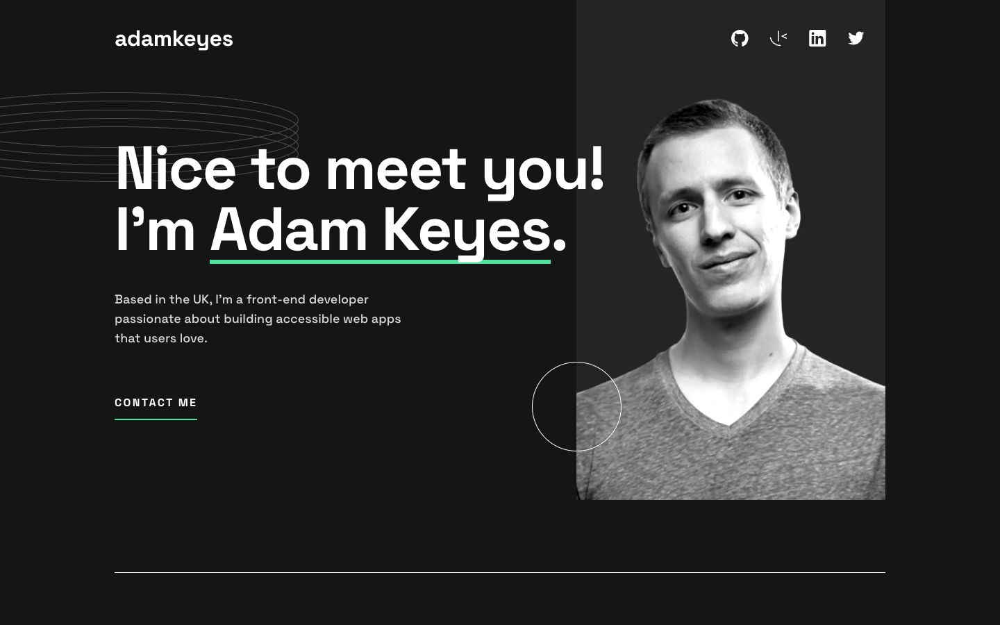

# Frontend Mentor - Single-page developer portfolio solution

This is a solution to the [Single-page developer portfolio challenge on Frontend Mentor](https://www.frontendmentor.io/challenges/singlepage-developer-portfolio-bBVj2ZPi-x). I built a responsive page for the sample developer, Adam Keyes, with skills, project previews and a demo contact form.

## Table of contents

- [Overview](#overview)
  - [The challenge](#the-challenge)
  - [Screenshot](#screenshot)
  - [Links](#links)
- [My process](#my-process)
  - [Built with](#built-with)
  - [What I learned](#what-i-learned)
  - [Continued development](#continued-development)
- [Run it locally](#run-it-locally)
- [Author](#author)

## Overview

### The challenge

Users should be able to:

- View the layout on mobile, tablet and desktop screens.
- See hover and focus states for interactive elements.
- Reach "View project" and "View code" links with a pointer or keyboard.
- Jump to the contact section using either "Contact me" link.
- Fill in the contact form and see errors for missing fields or an invalid email address.

### Screenshot



### Links

- Solution URL: [My Frontend Mentor solution](https://www.frontendmentor.io/solutions/developer-portfolio-with-nextjs-typescript-and-tailwind-hjM5OLwy4Q)
- Live Site URL: [Single-page developer portfolio](https://single-page-portfolio-fm.royeradames.com)

## My process

### Built with

- Next.js 16 and React 19
- TypeScript
- Tailwind CSS 4 and custom CSS with Grid, Flexbox and media queries
- TanStack Form and Zod for contact form validation
- Playwright for browser tests
- Self-hosted Space Grotesk

### What I learned

I learned that project links shown on desktop hover must also appear on keyboard focus. I use `:focus-within` alongside `:hover` to reveal the screenshot overlay. I limit that overlay to desktop screens with a fine pointer and hover support. On smaller screens and touch devices, I keep the links visible below each project.

I check the contact form on submit, then re-check fields as they are corrected. I use TanStack Form with a Zod schema for this. I link each error to its field with `aria-describedby` and move focus to the first invalid field, so the visitor can find what needs fixing.

### Continued development

- Replace the sample project destinations if I add real projects. "View project" currently opens the supplied preview image, and "View code" opens a GitHub repository search.
- Decide whether to use my own details for the brief's bonus. I currently keep Adam Keyes, the sample developer. This is an owner decision, so the audit scores the bonus as manual.

## Run it locally

Use Node.js 22.13.0 or later.

```sh
npm install
npm run dev        # development server
npm run lint
npm run typecheck
npm run build
npm test           # Playwright against the production build on port 4413
```

Run `npm run build` before `npm test`. The tests start the production server.

I keep the contact form as a demo. It sends and stores nothing, and its confirmation says so. Without JavaScript, the browser checks required fields and email format, then returns to the demo notice without sending field values.

I follow the 375, 768 and 1440 px Figma frames, but keep text at least 16 px. The form's error messages are 16 px instead of the design's 12 px. Design files from Frontend Mentor are not committed.

## Author

- Website - [Royer Adames](https://royeradames.com)
- Frontend Mentor - [@royeradames](https://www.frontendmentor.io/profile/royeradames)
